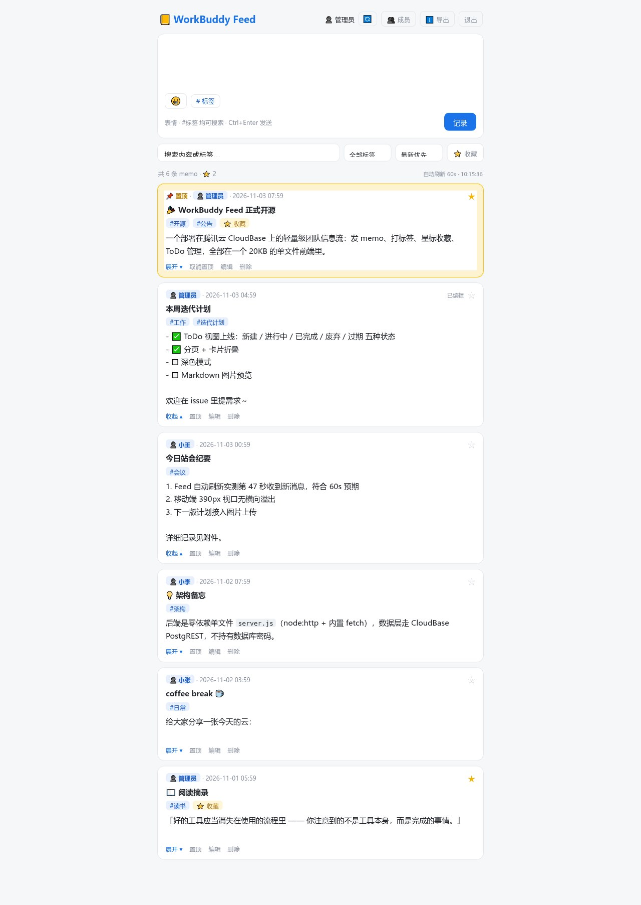
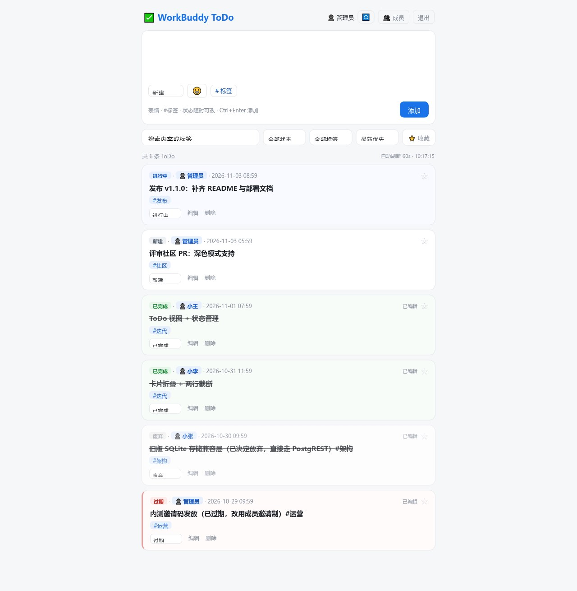
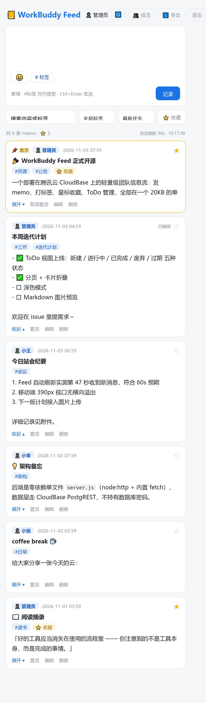

# 📒 WorkBuddy Feed

> **Agent 干完了活，你却不知道？** 让 AI 把日报、行情、待办主动推进一个你随时能看的地方 —— 一个信息流 + 待办看板，零依赖、零服务器成本。

<div align="center">

    

**Agent 主动推送** · **Feed 信息流** · **ToDo 看板** · **标签 & 收藏** · **成员体系** · **移动端适配**

</div>

---

## 🎯 解决什么问题

Agent 越用越多，但协作界面还停在「对话窗口」：

- **Agent 干完了什么，我不知道** —— 昨天的日报、跑完的分析、改完的代码，都沉在某个会话里，翻不到
- **新事件、新任务得靠我主动去看** —— 邮件、行情、待办全靠人盯，关掉对话就断了
- **结果散落各处** —— 一个会话一个窗口，没有一个统一收件箱

WorkBuddy Feed 就是给 Agent 用的**收件箱 + 布告栏**：Agent 干完活往里推一条，你打开就能看到；需要跟进的事推成一条 ToDo，状态一路跟到完成。

## 🤖 Agent 主动推送

仓库自带一个零依赖命令行客户端 `scripts/feed-cli.js`，Agent 干完活一行命令就能汇报，
**增删改查全支持**，输出默认精简（只回一行 id），适合 Agent 反复调用：

```bash
# 新建动态（正文里的 #标签 会被自动解析）
node scripts/feed-cli.js add "📊 今日工作日报 #日报
- 完成：Feed 支持 ToDo 视图
- 风险：CNB token 已过期"

# 新建待办（status: new / doing / done / dropped / expired）
node scripts/feed-cli.js add "跟进社区 PR #社区" --todo --status doing

# 查：列表（默认精简，每条一行）、按标签筛、全文搜索
node scripts/feed-cli.js list --limit 5
node scripts/feed-cli.js list --todo --status doing
node scripts/feed-cli.js list --tag 日报 --full
node scripts/feed-cli.js search 关键字

# 改：改内容、改状态、加收藏星标、置顶
node scripts/feed-cli.js update <id> --content "新内容"
node scripts/feed-cli.js update <id> --todo --status done
node scripts/feed-cli.js update <id> --fav

# 删
node scripts/feed-cli.js delete <id>
```

`list` 输出的是 8 位短 id，可以直接用在 `get` / `update` / `delete` 上，脚本会自动解析。

凭据通过环境变量传入（也支持 `FEED_KV_FILE` 指向一个 JSON 文件，或写进 `.env`）：

```bash
export FEED_BASE=https://your-app.example.com
export FEED_TOKEN=<成员免密 token>
export FEED_SHARECODE=<分享码>   # 托管网关要求每个请求都带
node scripts/feed-cli.js add "hello #tag"
```

> 长正文用 `--file report.md` 或 `cat report.md | ... --stdin`，避免命令行转义问题。
>
> 只想推内容、不需要查改删，可以用更精简的 `scripts/push.js`：
> ```bash
> node scripts/push.js --content "📊 今日日报 #日报"
> node scripts/push.js --type todo --status doing --content "跟进 PR #社区"
> ```

不想用脚本？它就是两个 HTTP 请求，任何语言都能接：

```bash
# 1) token 换会话 cookie
curl -s "https://<your-app>/api/auth?token=<MEMBER_TOKEN>" -c /tmp/c.txt -b /tmp/c.txt

# 2) 写入
curl -s -b /tmp/c.txt -X POST "https://<your-app>/api/memos" \
  -H 'Content-Type: application/json' -d '{"content":"📊 今日日报 #日报"}'
```

配上任意定时能力（WorkBuddy 自动化任务、cron、CI），就是一条完整的「Agent 主动汇报」链路：

```
定时触发 ──> Agent 执行（查邮件 / 拉行情 / 跑分析 / 写日报）
                 │
                 └──> scripts/push.js（或 POST /api/memos、/api/todos）
                           │
                           └──> 打开 Feed 就能看到（60s 自动刷新，手机随时看）
```

**典型场景**

| 场景 | Agent 每天干什么 | 落到哪 |
| --- | --- | --- |
| 📝 工作日报 | 凌晨汇总前一天的进展与卡点，生成一段日报 | Feed `#日报` |
| 📧 邮件日报 | 扫一遍收件箱，按紧急/重要聚类，提取行动项 | Feed `#邮件` |
| 📈 股市信息 | 收盘后拉行情与持仓变动，生成简报 | Feed `#行情` |
| ✅ 任务同步 | 日报里识别出的「待跟进事项」直接建 ToDo | ToDo（新建 → 进行中 → 已完成） |

> 一个信息流解决了 Agent 协作里最难的部分：**结果有人看、状态有人跟**。

## 🪶 极简 & 零成本

- **数据是一个文件** —— 全部落在 `data/feed.db`（SQLite），备份就是复制它，迁移就是拷走它
- **0 个 npm 依赖** —— `node:http` + `node:sqlite`，克隆下来 `node server.js` 就能跑，不需要 `npm install`
- **0 构建步骤** —— 前端是 20KB 单文件 HTML + 原生 JS，改完刷新即生效
- **0 配额、0 计费** —— 不依赖任何云数据库，没有"资源点""核·小时""实例被隔离"这些东西
- **一份数据，多个入口** —— 浏览器、手机、Agent 走同一套 REST API

> 整套东西：**1 个 JS 文件 + 1 个 HTML + 1 个 SQLite 文件**，跑在你自己的机器上。

## ✨ 功能一览

WorkBuddy Feed 把「随手记」和「待办管理」放进同一个界面：

- 📒 **Feed 视图** —— 像 memos 一样随时记录，首行自动成为标题
- ✅ **ToDo 视图** —— 点一下左上角 Logo 即可切换，条目带五种状态：`新建` `进行中` `已完成` `废弃` `过期`
- 🏷️ **标签** —— 正文里写 `#标签` 即自动解析，可筛选、可搜索
- ⭐ **收藏** —— 打个星就是收藏，筛选栏一键「只看收藏」
- 🙋 **成员体系** —— 管理员创建成员，免密 token 链接直接进入，消息带作者署名
- 🔄 **自动刷新** —— 每 60 秒静默刷新，手动刷新按钮随时可用；折叠状态不丢失
- 📄 **分页 + 折叠卡片** —— 每页 20 条；卡片默认折叠（标题 + 标签 + 正文两行），点击展开
- 📱 **移动端适配** —— 390px 视口无横向溢出，手机浏览器直接用

| Feed 视图 | ToDo 视图 |
| --- | --- |
|  |  |

<div align="center"></div>

## 🏗️ 架构

```
  浏览器 / 手机 ──┐
                  ├──> server.js（HTTP + 路由 + 会话，零依赖）
  Agent / 定时任务 ┘        │
                            ├── 静态资源：public/index.html（20KB，原生 JS）
                            └── 数据：src/db.js ──> data/feed.db（SQLite 单文件）
```

人和 Agent 走的是同一套 REST API —— 人点按钮、Agent 发请求，写进同一个 `feed.db`。

- **后端两个文件**：`server.js`（HTTP / 路由 / 会话）+ `src/db.js`（SQLite 数据层），零 npm 依赖，`node >= 22.5`（`node:sqlite` 内置）
- **数据**：本地 SQLite，WAL 模式，读写不互相阻塞；单文件，直接拷走就能换机器
- **认证**：密码登录 + 无状态 HMAC 签名 cookie；`GET /api/auth?token=xxx` 支持免密登录链接
- **备份**：`npm run backup` 用 `VACUUM INTO` 生成一致性快照到 `data/backups/`（服务运行中也能备份，默认保留 14 份）

> **为什么不用云数据库？** 踩过坑：CloudBase 的 PostgreSQL 共享实例按 **342 资源点/(核·小时)** 计费，5 分钟一个计量档，
> 体验版每月 3,000 点只够 **约 17.5 小时"数据库有访问"的时长** —— 开发调试两天就烧完，实例随即被平台隔离、
> 全站不可读写，数据还导不出来。这类"按机器在线时长收费"的数据库根本不适合低频小应用。
> 换成本地 SQLite 后：没有配额、没有计费、不会被停机，数据始终在自己手上。

## 🚀 快速开始

### 1. 启动

```bash
git clone https://github.com/EvilJoker/workbuddy-feed.git
cd workbuddy-feed

cp .env.example .env      # 改一下 ACCESS_PASSWORD 即可，其他可留空
node server.js            # 默认监听 8080，首次启动自动建库到 data/feed.db
```

要求 **Node >= 22.5**（`node:sqlite` 是内置模块，不需要 `npm install`，也不需要装数据库）。

`.env` 说明见 [`.env.example`](.env.example)，每一项都有注释。

### 2. 使用

浏览器打开 `http://localhost:8080`，输入访问密码即可。

- 首位使用者即管理员，右上角「成员」里可以创建成员并复制免密登录链接
- 写 `#标签` 自动归类；点卡片右上角 ☆ 收藏；点左上角 Logo 切换 Feed / ToDo

### 3. 让 Agent 开始推送

1. 在「成员」里为 Agent 建一个成员，拿到免密 token
2. 照 [「Agent 主动推送」](#-agent-主动推送) 里的 curl 发一次，确认 Feed 里能看到
3. 把这条请求挂到定时任务上（WorkBuddy 自动化 / cron / CI）—— 之后每天凌晨，日报、邮件摘要、行情简报都会自己出现在 Feed 里

### 4. 备份与迁移

```bash
npm run backup            # -> data/backups/feed-20261103-1930.db（一致性快照，默认保留 14 份）
KEEP=30 npm run backup    # 保留 30 份
```

- 数据就在 `data/feed.db`（外加 `-wal` / `-shm` 两个伴生文件），**整个 `data/` 目录拷走就等于搬家**
- 恢复：停服务 → 用备份文件覆盖 `data/feed.db` → 删掉旧的 `-wal` / `-shm` → 起服务
- 想放到别的磁盘：`DB_PATH=/mnt/data/feed.db node server.js`

> **托管到容器平台时**：库文件默认会被放到 `<项目根>/.feed-data/feed.db`（判断依据是存在 `/workspace` 目录），
> 也就是**故意放在项目目录之外** —— 因为重新部署会重传项目目录，库放里面会被覆盖。
> 想让库跟着项目走，就显式设 `DB_PATH`，然后自己保证部署不会覆盖它。


## 🔌 API 一览

| 方法 | 路径 | 说明 |
| --- | --- | --- |
| GET | `/api/health` | 健康检查 |
| POST | `/api/login` | 密码登录，签发 cookie |
| GET | `/api/auth?token=` | 成员免密登录 |
| GET | `/api/me` | 当前身份 |
| GET/POST | `/api/memos` | 列表 / 发布（自动解析 `#标签`）<br>列表支持服务端过滤：`?limit=&offset=&tag=&q=&fav=1` |
| GET/PATCH/DELETE | `/api/memos/:id` | 单条查询 / 编辑（重解析标签、保留收藏）/ 删除 / 置顶 / 改标签 |
| GET | `/api/memos/export` | 导出 JSON |
| GET/POST | `/api/todos` | ToDo 列表 / 新增（可带 `status`）<br>列表支持服务端过滤：`?limit=&offset=&tag=&status=&q=&fav=1` |
| GET/PATCH/DELETE | `/api/todos/:id` | 单条查询 / 改状态 / 编辑 / 删除 |
| GET/POST | `/api/users` | 成员管理（仅管理员） |

## 📁 目录结构

```
workbuddy-feed/
├── server.js            # HTTP / 路由 / 会话（零依赖）
├── src/db.js            # SQLite 数据层：建表 + CRUD（node:sqlite）
├── public/index.html    # 单文件前端（原生 JS，无构建）
├── sql/schema.sql       # 建表 SQL（参考用，服务启动会自动建）
├── scripts/feed-cli.js  # Agent 命令行客户端（增删改查，输出精简省 token）
├── scripts/push.js      # Agent 精简推送脚本（只要写入时用）
├── scripts/backup.js    # 一致性备份（VACUUM INTO）
├── scripts/smoke.py     # 本地冒烟测试（21 项，覆盖 memos / todos / users）
├── scripts/import.js    # 从旧服务 JSON 导入历史数据
├── data/                # SQLite 数据文件 + 备份（已 gitignore）
├── .env.example         # 环境变量模板
└── docs/screenshots/    # 截图
```

## 🛡️ 安全提示

- 访问密码 `ACCESS_PASSWORD` 是唯一入口，请使用强密码；成员免密 token 请当作密码保管
- 更换 `SESSION_SECRET`（或密码）会使所有人的登录状态失效
- `data/` 里就是全部业务数据，注意目录权限；别把它提交进仓库（已在 `.gitignore`）
- 对外暴露时放在 HTTPS 反代后面，并把 `COOKIE_SECURE=1`

## 📜 License

[MIT](LICENSE)
